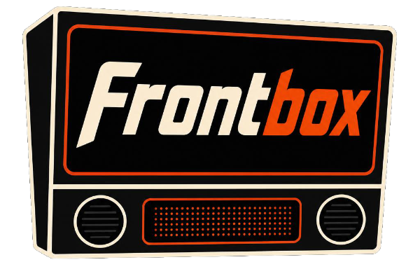
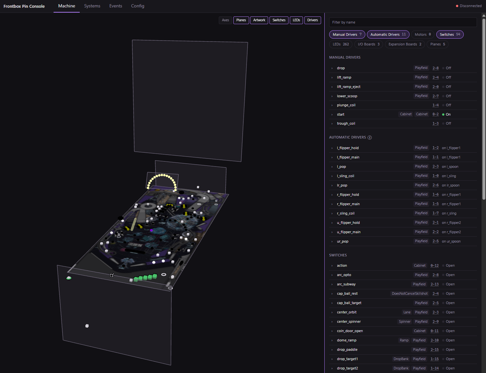

## Overview

Frontbox is a homebrew arcade framework built for [FAST Pinball](https://fastpinball.com/) hardware, designed around an actor-like constructs called "Systems", which send and receive signal.

> [!WARNING]
> Frontbox is in active, pre-release development with unstable APIs

### Features

- **Lightweight**: Built in [Rust](https://rust-lang.org/) to run on minimal hardware
- **Flexible**: All hardware can be referenced in 3 ways: by name, tag, or location in space
- **Retro**: Pin2DMD and NeoSeg\* (alpha numeric) display support out of the box
- **Visual**: Included Web Console shows what is happening (see below)
- **Dazzling**: 1D, 2D*, and 3D* LED animations
- **Data-backed**: Built-in metrics system and historical viewer
- **Sonically Immersive**: Sound system with preloading and automatic music ducking\*

\* = Coming Soon

### Web Console

## Frequently Asked Questions

#### Q: Is Frontbox an AI port of \_\_\_\_\_\_\_\_ Framework?

A: No. Frontbox was started in [early](https://github.com/tstone/rpin/commit/97c487882d456c3d43141c703f834bf265f3042f) [2025](https://www.youtube.com/shorts/eDWzkOEvjT4) (originally called "rpin") before widespread agentic coding was even a thing.

#### Q: How is Frontbox different than \_\_\_\_\_\_\_\_ Framework?

A: Frontbox isn't a dedicated "pinball framework". It's a hardware framework that happens to have optional pinball components you can opt-in to. This gives it a more generalized, code-centric approach to things, in which there are fewer abstractions to understand and more opportunity to swap about base functionality. You could even for non-pinball, such as a homebrew claw machine -- really anything that was running on hardware Frontbox supports.

#### Q: Does Frontbox work with Godot, Unity, or Unreal? Will it?

A: Not officially. Frontbox actually started as a plugin for [Bevy](https://bevy.org/), which is where I'd look if I were wanting to make an LCD game. For the moment, the trajectory for Frontbox is to treat DMD and alphanumeric displays with first-class support for game display, and to utilize the web console for any complex management tasks.

#### Q: Is Frontbox AI friendly?

A: It will be. An [AGENTS.md](AGENTS.md) is slowly being built up which contains best practices and hints for agents.

#### Q: Is there a documentation site?

Q: Not yet. Frontbox uses [rustdoc](https://doc.rust-lang.org/rustdoc/what-is-rustdoc.html), which generates a documentation site on publish. Since the framework isn't yet published, the doc site isn't yet published either. It's possible to view it locally by cloning the repo then running `cargo doc --open`.

#### Q: Let's say I just wanted to try it, what's still missing?

A: Some notable things. You probably should wait.

- Core pinball:
  - extra balls
  - tilt
  - ball search
  - outlane saves
  - high scores
- Machine management:
  - Automatic startup eject
  - coin based credits
  - automatic USB reconnects
- LEDs: 2D and 3D animations (1D supported)
- Hardware: Motors, servos, NeoSeg
- Display support outside of Pin2DMD
- Sound: loop points, multi-stem music
- Centralized random seed management

#### Q: How do I set this up? Is there an example.

A: Yes:

- Included [examples](frontbox/examples)
- Or [Last of the Kilmore Oaks](https://github.com/tstone/lotko-homebrew) for source of a full game

## Guides

(these will link to published docs once live)

- App -- Booting things up
- Hardware -- Defining what exists
- Systems -- The behavorial unit everything happens within
- Drivers -- Turning things like coils on and off
- Switches -- Capturing input
- LEDs -- Lighting things up
- DMD -- Dot matrix display rendering
- Operator Config -- Settings the operator can change from the menu

## License

Frontbox is dual licensed Apache + MIT.

## AI Usage

This project generally follows the [Rust language LLM use policy](https://forge.rust-lang.org/policies/llm-usage.html).

- It’s fine to use LLMs to answer questions, analyze, distill, refine, check, suggest, review. But not to **create**.
- LLMs work best when used as a tool to write _better_, not _faster_.

**Design ("style") should be human-driven.** Frontbox is not "vibe-coded".
