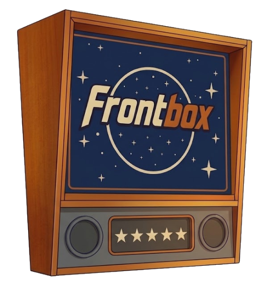

  

## Overview

Frontbox is a homebrew arcade framework, with pinball inclinations, built for [FAST Pinball](https://fastpinball.com/) hardware.

> [!WARNING]
> Frontbox is in active, pre-release development with potentially unstable APIs

### Status

**In**: 
  - Core framework (systems, events, routines, states)
  - FAST protocol handshaking, boot sequence, and watchdog management
  - Hardware support: drivers (coils), switches, and LEDs
  - Ball management (trough, plunge lane, auto-plunger)
  - Competitive game management (game lifecycle, player tracking, turn tracking, extra ball, etc.)
  - DMD display rendering
  - Free play and tilt support
  - Music playback, sound effect playback, and callback playback with ducking
  - Operator config (adjustable game/hardware settings)
  - Metrics tracking
  - Web-based management console

**Still Missing**: 
  - Ball search
  - High scores
  - 2D and 3D LED animations
  - Cooperative game management
  - DMD screen management
  - Alphanumeric display/NeoSeg support
  - Hardware support: motors and servos
  - Coin-based game start
  - Music loop points, effects, and multi-stem playback

### Architectural Overview

Frontbox is built around a single abstraction called a `System`. Systems can both send and receive `Events`. Events are typed and always broadcast: every active system receives a copy. Systems can also directly interact with each other in a typesafe way, typically to perform actions (eject the ball, lift the ramp, etc.) which removes the need to send a specific event to a specific system.

Systems can also participate in a `Routine`, which is an ordered processes where each participating system gets to hold the baton, do it's thing, then let it passdown to the next system. These work similar to the concept of middleware in HTTP routing. Routines, likewise, are typesafe and can be initialized by user systems, but the framework comes with notable ones built in (GameStarting, TurnStarting, BallDraining, TurnEnding, GameEnding, etc.).

Systems can be grouped or go active/inactive independently. Systems interact with `Context`, which contains the current hardware on the machine, `States`, a reference to other systems, and is how framework-level behavior is activated (spawn system, despawn, self, etc.) States are special enums within Context that emit events automatically on change, and are typically reacted to by other systems.

#### A Basic Game Lifecycle Example

- The start button is pressed. This causes a switch event.
- The `FreePlaySystem` receives the switch event then checks the `PlayerEntry` state. It is currently `PlayerEntry::Open`.
- `FreePlaySystem` calls `GameManagement` (through context) to invoke `add_player`.
- `GameManagement` adds the player, recognizes this is the first player and starts a game.
- Event `RoutineStarted<GameStarting>` is emitted.
- Systems participating in `GameStarting` are run in order (by the framework)
- Event `RoutineCompleted<GameStarting>` is emitted.
- It's now the first player's turn, so the game manager starts that turn.
- Event `RoutineStarted<TurnStarting>` is emitted.
- Systems participating in `TurnStarting` are run in order (by the framework). At this point there could be interactions for the player, such as choosing their character.
- Event `RoutineCompleted<TurnStarting>` is emitted.
- The ball is served into the plunge lane by `TroughSystem`, which is part of ball management. It verifies the ball enters the plunge lane via a switch event.
- The `TurnPhase` is currently `TurnPhase::Starting`.
- The player pulls the plunger back and the ball rockets forward. As it lands in the playfield it hits a playfield switch, causing the turn phase to change to `TurnPhase::Active`.
- A `BallActive` event is emitted.
- A `SkillShotTargetsSystem` was running. Its `is_active` state was set to `ctx.in_state(TurnPhase::Active)`
- The ball hits a target, causing another switch event
- `SkillShotTargetsSystem` recognizes the switch event is for its target, so it calls `ctx.add_points` to award the player points. It also applies an LED effect during its `on_tick` handler, and plays a sound effect via `ctx.play_sfx`.

## Frequently Asked Questions

#### Q: Is Frontbox an AI port of \_\_\_\_\_\_\_\_ Framework?

A: No. Frontbox was started in [early](https://github.com/tstone/rpin/commit/97c487882d456c3d43141c703f834bf265f3042f) [2025](https://www.youtube.com/shorts/eDWzkOEvjT4) (originally called "rpin") before widespread agentic coding was even a thing.

#### Q: How is Frontbox different than \_\_\_\_\_\_\_\_ Framework?

A: Frontbox core is a hardware framework with no built-in pinball concepts. It supports broadcast events, system-to-system interaction, and sequenced processes ("routines"). Frontbox pinball adds an option layer of pinball behavior on top of that, including ball management, game management, tilt, extra balls, score keeping, etc. Your game is then built on any combination of those you want. Traditional pinball is support out of the box, but picking and choosing enables other types of games. You could even build a homebrew claw machine on Frontbox core with FAST hardware.

#### Q: Does Frontbox work with Godot, Unity, or Unreal? Will it?

A: No, not yet anyways. The current focus is to optimize for DMD and alphanumeric displays as first-class supported for game display, then to utilize the web console for any complex management tasks. Though I'm sure something is possible for the adventurous. Frontbox actually started as a plugin for [Bevy](https://bevy.org/), which is where I'd look if I were wanting to make an LCD game.

#### Q: Is Frontbox AI friendly?

A: Frontbox was designed firstly to be a programmer-friendly framework, with minimal abstractions, consistent naming, and intuitive interfaces. But it turns out those decisions also work well for agents too, and now days most builders will likely use some form of agentic assistance to build up game code. An [AGENTS.md](AGENTS.md) is slowly being built up which contains best practices and hints for agents. More to come.

#### Q: Is there a documentation site?

A: Not yet. Frontbox uses [rustdoc](https://doc.rust-lang.org/rustdoc/what-is-rustdoc.html), which generates a documentation site on publish. Since the framework isn't yet published, the doc site isn't yet published either. It's possible to view it locally by cloning the repo then running `cargo doc --open`.

#### Q: How do I set this up? Is there an example.

A: Yes:

- Included [examples](frontbox/examples)
- Or [Last of the Kilmore Oaks](https://github.com/tstone/lotko-homebrew) for source of a full game

### Web Console

## Guides

(these will link to published docs once live)

- App -- Booting things up
- Hardware -- Defining what exists
- Systems -- The behavioral unit everything happens within
- Drivers -- Turning things like coils on and off
- Switches -- Capturing input
- LEDs -- Lighting things up
- DMD -- Dot matrix display rendering
- Operator Config -- Settings the operator can change from the menu

## License

Frontbox is dual licensed Apache + MIT.
